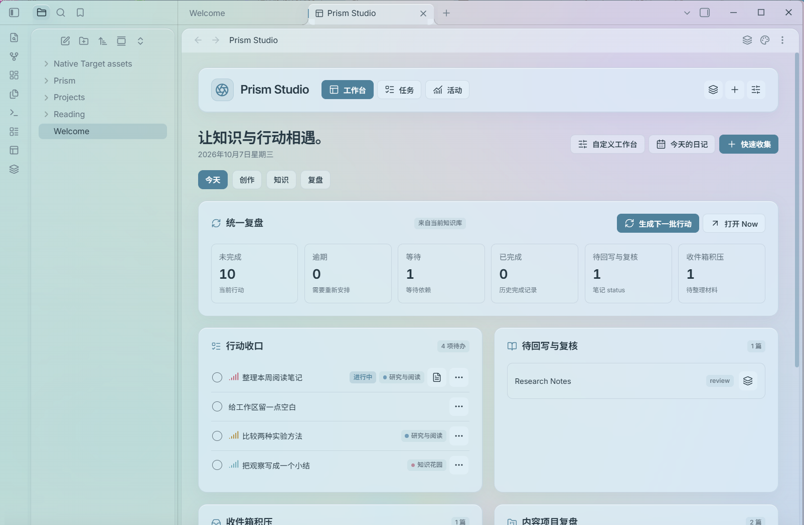
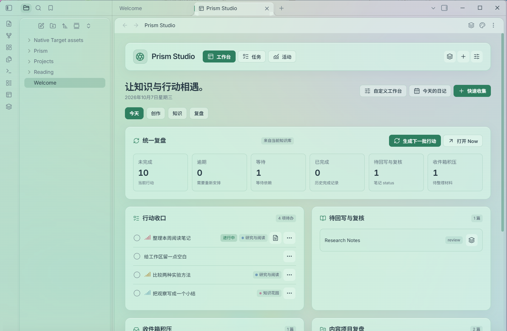
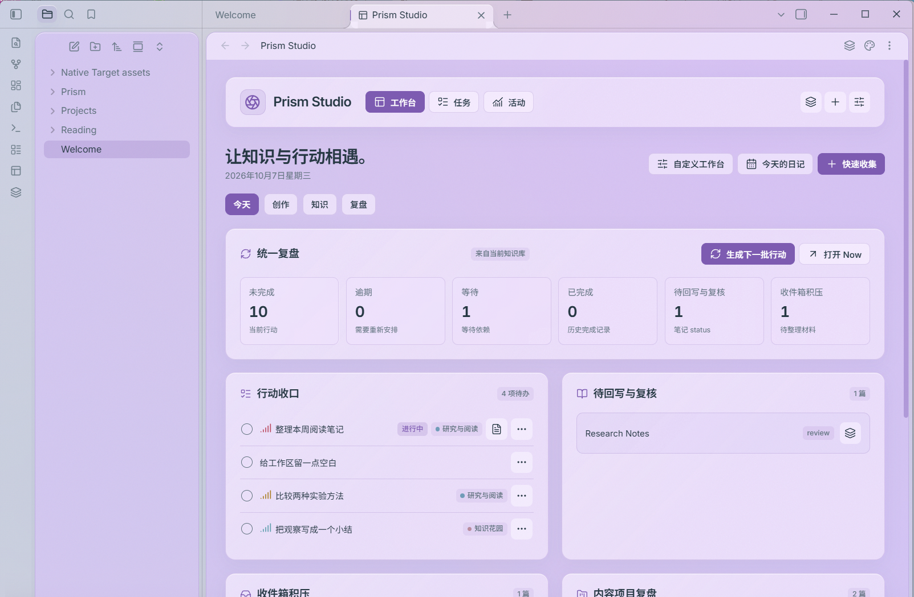
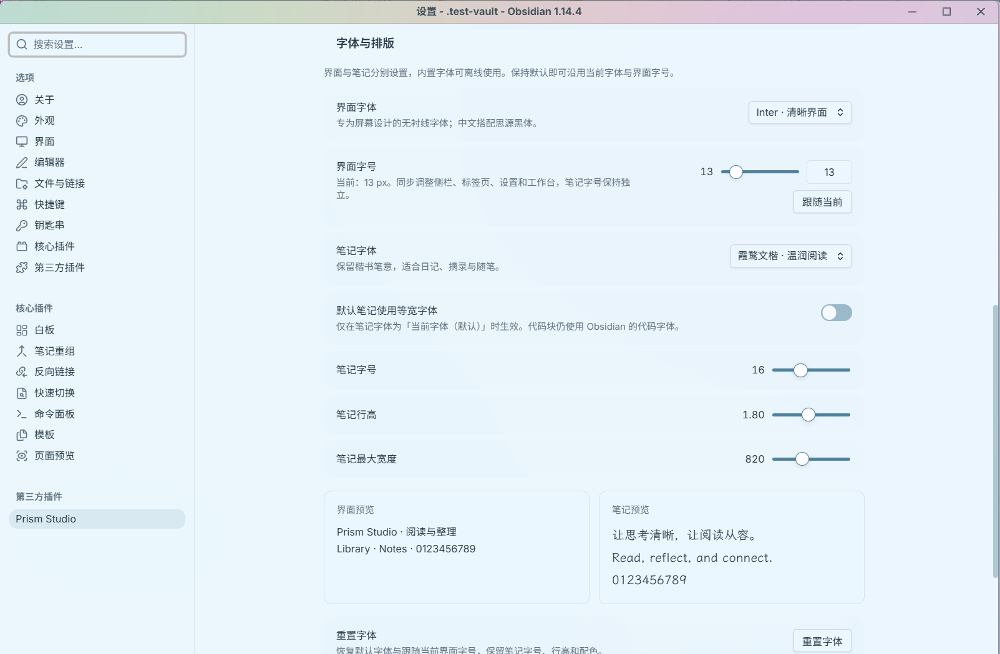
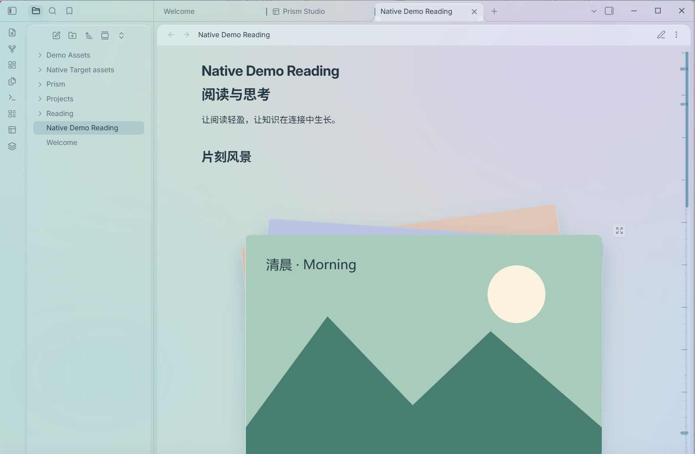

# Prism Studio

English · [中文说明见下](#中文说明)

Prism Studio is an Obsidian plugin that gives your workspace a translucent, light-on-the-eyes look and turns it into a working hub: **18 palettes, 5 materials, separate interface and note fonts**, a section scrollbar, automatic image decks, floating notes, and a customizable home dashboard.

- **Appearance** — Palettes and materials mix freely in light and dark mode. Panels keep a soft blur, and the desktop window can ride on system translucency where available.
- **Reading** — A section rail shows ticks, headings and hover previews; consecutive images stack into decks that expand or collapse.
- **Floating notes** — Open any note in a movable window, edit with drafts and recovery, and pop out to a native window on desktop.
- **Workbench** — Tasks in a five-lane board, projects and sprints, a contribution heatmap, recents by creation time and modification, and per-widget visibility settings.
- **Local only** — All data stays in your vault (`data.json`). No network requests, no telemetry.

Install from **Settings → Community plugins → Browse → Prism Studio**, or download the latest release from [GitHub](https://github.com/menoking/Prism-Studio/releases/latest). MIT licensed.

---

## 中文说明

让 Obsidian 的阅读与工作空间更轻盈。

Prism Studio 提供 **18 套配色、5 种材质、独立的界面与笔记字体**，并加入章节滚动条、自动图片堆叠、浮动笔记与可定制工作台。配色与材质可以自由搭配，支持浅色和深色模式。

[下载最新版本](https://github.com/menoking/Prism-Studio/releases/latest) · [完整使用教程](<Prism Studio 使用教程.md>) · [字体来源与许可](FONTS.md)



> 截图拍摄于 Windows 上的 Obsidian 1.14.4，插件版本为 1.5.1。内容来自独立演示知识库；窗口后方使用受控渐变背景，背景颜色会透过玻璃染层影响最终观感。

## 主题效果

桌面端窗口右上角、最小化按钮左侧提供图钉开关。点击将当前窗口固定到最顶层，图钉高亮；再次点击取消。弹出笔记窗口可以分别置顶，关闭主题皮肤后仍可使用。也可以在命令面板执行 **切换窗口置顶**，并为它设置快捷键。置顶状态只在当前会话内生效。

| 薄荷 · 玻璃 | 紫雾 · 亚克力 |
| --- | --- |
|  |  |

所有配色都能搭配以下材质，按钮、滚动条、图片卡片和浮动笔记会同步跟随所选配色。

| 材质 | 表现 |
| --- | --- |
| 玻璃 | 通透、轻染色，较明显地保留背景色彩 |
| 亚克力 | 更浓的颜色、细颗粒与轻高光，面板更厚实 |
| 毛玻璃 | 乳白或灰雾磨砂，弱化背景细节 |
| 柔焦模糊 | 轻染色与较强模糊，柔化背景干扰 |
| 纯色 | 不透明面板，暂停桌面透视 |

**18 套配色：** 浅蓝、冰蓝、极光、落日、湖泊、紫雾、薄荷、鼠尾草、松林、青瓷、深海、薰衣草、玫瑰、蜜桃、琥珀、沙丘、珍珠、暮色。

## 安装与升级

1. 在 [Releases](https://github.com/menoking/Prism-Studio/releases/latest) 下载完整安装包，解压。
2. 将完整的 `prism-studio` 文件夹复制到知识库的 `.obsidian/plugins/` 下。
3. 打开 Obsidian → 设置 → 第三方插件，启用 **Prism Studio**。
4. 进入 **设置 → Prism Studio** 调整配色、材质和字体，或点击左侧 Prism Studio 图标打开工作台。

安装后的目录应为：

```text
你的知识库/
└─ .obsidian/plugins/prism-studio/
   ├─ main.js
   ├─ manifest.json
   ├─ styles.css
   └─ fonts/
      ├─ *.ttf
      ├─ LICENSE-*.txt
      └─ SOURCES.json
```

**请完整保留 `fonts/` 文件夹。** 插件自带 8 个开放字体家族，约 57 MiB；字体按需从本地加载，不依赖 CDN，也不需要安装到操作系统。

升级时覆盖插件运行文件和字体目录，保留 `data.json`。使用源码目录中的安装脚本会自动备份旧版本与数据：

```powershell
.\scripts\install.ps1 -VaultPath "你的知识库完整路径"
```

Release 中的 `Install-Prism.ps1` 可与解压后的 `prism-studio` 文件夹放在同一目录，然后运行：

```powershell
.\Install-Prism.ps1 -VaultPath "你的知识库完整路径" -PluginPath ".\prism-studio"
```

## 字体与排版

界面与笔记分别设置。默认选项 **当前字体（默认）** 保留原有字体；界面字号默认跟随现有主题。

| 设置 | 选择 |
| --- | --- |
| 界面字体 | 7 个选项，含 Inter、Noto Sans SC、Manrope、IBM Plex Sans、文楷与系统简约 |
| 界面字号 | 12–20 px；支持滑块、直接输入和恢复跟随当前字号 |
| 笔记字体 | 10 个选项，含黑体、宋体、文楷、Literata、技术等宽及简约/书刊风格 |
| 笔记排版 | 字号 12–24 px、行高与最大宽度分别调整 |



“系统简约”与“系统书刊”参考苹果的排版审美：本机字体可用时优先使用，否则采用内置开放字体组合。插件不分发 Apple 字体。字体选择会显示中英文与数字预览，调整即时保存。

**重置字体**只恢复默认字体与界面跟随字号，保留笔记字号、行高和配色。旧等宽开关仅在默认笔记字体下生效；代码块继续使用 Obsidian 的代码字体。详细来源与授权见 [FONTS.md](FONTS.md)。

## 阅读与图片



- **章节滚动条：** 刻度、章节标记、悬浮小标题；支持拖动、点击和键盘导航。鼠标滚动保留编辑器焦点与光标，避免正在编辑的长代码块因失焦变回预览。
- **自动图片堆叠：** 阅读模式下，连续图片自动组成层叠卡组，同一行多张图片也能识别。
- **展开与收起：** 右上角淡色图标控制展开；展开后有吸顶收起图标和组末尾收起按钮。
- **图片比例：** 默认按原比例叠放，完整保留内容；也可选择居中裁切铺满卡片。展开始终显示完整原图。
- **浮动笔记：** 多窗口、层叠排列、拖动、缩放、最小化，支持 Markdown 阅读、编辑与恢复草稿。

连续图片使用普通 Wiki 或 Markdown 图片语法即可，也可明确指定一组：

````markdown
```prism-deck
![[Assets/image-1.png]]
![[Assets/image-2.png]]
![[Assets/image-3.png]]
```
````

图片效果只改变渲染，不改写 Markdown 或图片文件。关闭图片动效或启用系统减少动态效果时，卡组采用平铺显示。

## 工作台、任务与活动

| 模块 | 功能 |
| --- | --- |
| 内容工作台 | 收集、复核、项目、最近笔记、标签与系统节奏；每个组件可自由显示或隐藏 |
| 任务 | 七类任务分组、项目、周期、截止日期、优先级、列表与拖放看板 |
| Markdown 互通 | 导入复选框任务，完成状态回写原笔记，支持导出 |
| 活动统计 | 新建/改写字词、创建笔记、完成任务、内链、编辑时长与手动专注记录 |

活动只从启用后记录，保存在本地，可在设置中关闭。时长为采样估计，贡献墙计算方式见 [使用教程](<Prism Studio 使用教程.md>)。

## 平台与玻璃效果

- 最低 Obsidian 版本为 **1.5.0**；本版本在 **Windows / Obsidian 1.14.4** 完成实机截图与运行检查。
- Windows 11 22H2+ 使用系统 Acrylic；macOS 接入原生 vibrancy，尚未在本项目环境实测。
- 桌面透视依赖系统透明效果、图形加速与较新的 Obsidian 安装程序。失焦、节能或系统设置可能减弱透明度。
- 不支持原生玻璃的平台仍可使用配色与面板材质，并可指定知识库内的备用背景图片。
- “面板模糊”调整界面内部内容的模糊；桌面背景模糊由操作系统控制。亚克力、毛玻璃和柔焦保留基础雾感。
- 移动端使用响应式布局，但移动设备与触摸操作尚未实测。

原生材质行为参考 [Electron 官方说明](https://www.electronjs.org/docs/latest/api/browser-window/#winsetbackgroundmaterialmaterial-windows)。

## 数据与卸载

设置、任务、项目、周期、活动与恢复草稿保存在 `.obsidian/plugins/prism-studio/data.json`。快速收集、日记与导出内容保存在普通 Markdown 文件中。

停用插件会移除全局皮肤覆盖并恢复原主题，不修改原有主题选择或 CSS 片段配置。卸载前请按需备份 `data.json` 或导出任务。

## 开发

需要 Node.js 22+、npm、Python 3 和 curl。首次从源码构建时下载锁定字体，再构建：

```powershell
npm ci
python scripts/fetch-fonts.py --locked
npm run build
npm test
npm run package
```

字体的来源与 SHA256 记录在 `fonts/SOURCES.json`，许可证随源码与发行包保留。发行包包含完整插件与文档，校验值在 `release/SHA256.json`。

原生交互检查与截图脚本只操作 `.test-vault` / `.test-profile` 中的演示库。通过 `OBSIDIAN_EXE` 指定本机 Obsidian 可执行文件，必要时用 `PRISM_THEME_SOURCE` 指定本机 Blue Topaz 主题目录。

```powershell
npm run test:typography
node scripts/capture-screenshots.mjs
```

GitHub Actions 会在主分支更新后进行构建与单元检查，并发布当前版本的 Release。源码与示例由本仓库维护；字体按各自的 **SIL Open Font License 1.1** 分发，详见 `fonts/LICENSE-*.txt`。
